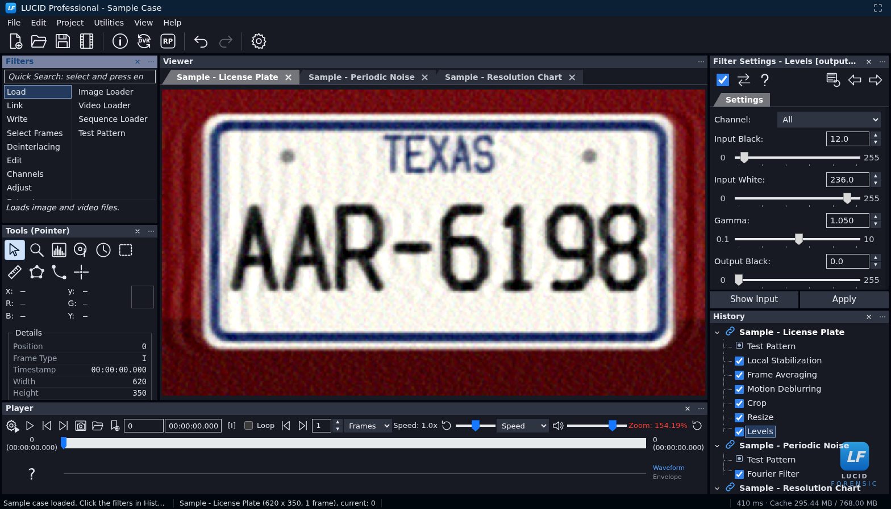
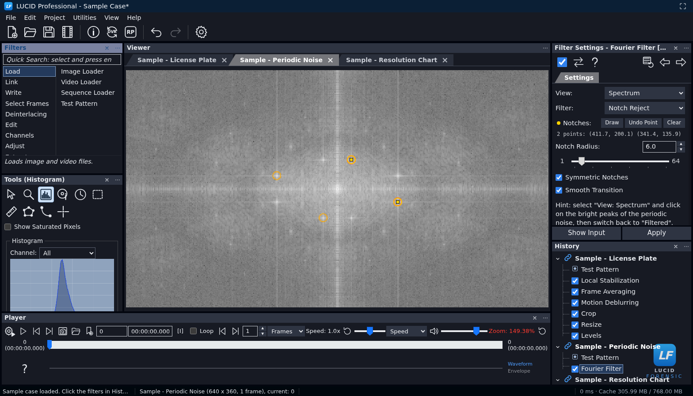
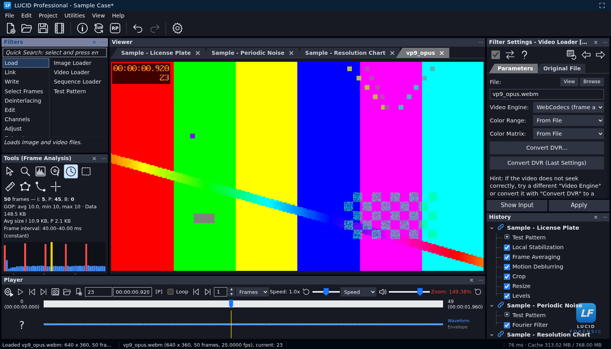

# LUCID Forensic Workbench

**Forensic image and video enhancement that runs entirely in the browser.** The user interface reproduces the
panel layout of the reference desktop forensic suite (Filters, Tools, Viewer, Filter Settings, History, Player)
on a dockable [Trellis](https://trellisui.com) workspace. All processing happens locally, in a Web Worker, on a
32‑bit floating point pipeline. No media ever leaves the machine.

**▶ Live app: [dogecoin87.github.io/ClearUFO-Forensics-Tool](https://dogecoin87.github.io/ClearUFO-Forensics-Tool/)**: nothing to
install. The page only delivers the app; your media is still processed entirely in your browser and is never uploaded.
Portable single-file version: [LUCID-Forensic-Workbench.html](https://dogecoin87.github.io/ClearUFO-Forensics-Tool/LUCID-Forensic-Workbench.html)
(right-click › *Save link as…* to keep an offline copy).



| Fourier notch filter (periodic noise) | GOP / frame analysis with frame-accurate decoding |
|---|---|
|  |  |

---

## Quick start

```bash
npm install
npm run dev          # http://localhost:5173  (development)
npm run build        # type-check + production build into ./release
npm run preview      # serve ./release on http://localhost:4173
npm test             # unit tests (hashing, DSP kernels, uncompressed writers); their cross-checks need Python 3 with
                     #   python3 -m pip install -r tests/requirements.txt   (numpy, Pillow, imageio-ffmpeg)
npm run test:lossless  # every lossless export checked with ffmpeg/zipfile (needs the dev server, see URL)
npm run test:ai        # the AI assistant end to end against a mock model server (needs the dev server)
```

`npm run build` also writes **`release/LUCID-Forensic-Workbench.html`**: a single self-contained 1.5 MB file
(engine included) that can be opened straight from disk (`file://`), archived with a case or used offline — in
Chrome, Edge, Firefox and Safari. (Safari does not let background workers of pages opened from disk read files, so
there the engine runs in the page: everything works, but the interface can pause during heavy filters. Serving the
`release` folder from any web server avoids this.)

**Hosting:** every push to `main` is unit-tested, built and published to GitHub Pages by
[`.github/workflows/pages.yml`](.github/workflows/pages.yml) (**Actions › Deploy to GitHub Pages › Run workflow** redeploys
by hand); if a test fails, the site keeps the previous version. `release/` is plain static files with relative paths, so
any static web server or sub-folder works as well. Serve it over HTTPS (or from `localhost`): browsers only enable
features such as WebGPU, the clipboard and private file storage on secure pages.

Try it without any evidence: **Help › Load Sample Case** builds three deterministic synthetic chains
(degraded license plate, periodic noise, resolution chart). Or let the assistant drive: **Ctrl+I**, set up a model
(**AI Settings**), and ask *“Load the sample case and explain what each chain does”*.

---

## Interface (same layout as the reference suite)

| Area | Content |
|---|---|
| Title bar / menus | `File · Edit · Project · Utilities · View · Help`, full keyboard navigation |
| Toolbar | New · Open · Save · Write Video │ File Info · Convert DVR · Report │ Undo · Redo │ Settings |
| **Filters** | Quick Search (type + Enter), categories / filters columns, description line. Double‑click or drag a filter to add it after the selected one |
| **Tools** | Pointer/inspector (x, y, R, G, B, Y, frame type, timestamp, frame MD5) · Zoom + navigator · Histogram (RGB/Y, saturated pixels, min/max/mean/σ, per‑channel MD5) · File Info · Frame Analysis (GOP chart, I/P/B, sizes, VFR) · Selector · Ruler · Polygon area · Intensity profile · Crosshair |
| **Viewer** | One tab per chain, zoom (wheel around cursor), **Sharp display: every image pixel the same size at any zoom** (Nearest / Smooth selectable; *Actual Pixels* on scaled screens), pan, saturated‑pixel overlay, **interactive editing of filter parameters on the image** (regions, points, polylines, lines), welcome screen, drag & drop |
| **Filter Settings** | `Filter Settings - <Filter> [input/output] [updated/modified]`, enable, show input, help, reset, previous/next, tabs, slider + spin box rows, PSF preview, curve editor, Show Input / Apply |
| **History** | Tree of chains → filters with enable check boxes; click = view, double click = configure, right click = menu, drag to reorder, Del, error highlighting |
| **Player** | Play/pause, first/last, snapshot, export, bookmarks, frame/time entry, frame type, loop, step N frames/seconds, **speed 0.01×–16×** (presets, exact entry, `[` / `]`; below 1× no frame is skipped), volume, zoom readout, timeline with In/Out range and bookmarks, audio waveform/envelope |
| **AI Assistant** | Chat with an agent that operates the application (tab next to History, toolbar ✦, **Ctrl+I**); see *AI Assistant* below |
| Status bar | Messages, `file (W x H, N frames, fps), current: X`, task progress, render time and cache usage |

Panels can be hidden (×) and restored (View menu), floated, maximized (double‑click the header) and re‑docked;
extra viewers can be docked side by side (*Open in New Viewer*). The layout persists between sessions.
Two themes: **Midnight** (current suite look) and **Classic Graphite**.

### Phones, tablets and touch screens

Windows narrower than 900 px or shorter than 540 px switch automatically to a **compact layout** made of the same
panels: *portrait* stacks Viewer / Player / a tab group (Filters · Settings · History · Tools); *landscape* puts the
Viewer and Player on the left and the tab group on the right. **View › Layout** (or Settings) forces *Desktop* or
*Compact*; each layout remembers its own customizations, and rotating the device keeps the panels' state.
The Player wraps its controls under the timeline, the toolbar and menu bar scroll horizontally, and lists and menus
get finger-sized rows.

| Gesture | Action |
|---|---|
| Tap / double‑tap | Click / double‑click (e.g. double‑tap a filter to add it, a History step to configure it) |
| Long‑press | Context menu (History, chain tabs, Viewer) |
| Pinch · two‑finger drag | Zoom around the fingers · pan (always available, also while editing regions) |
| One‑finger drag on the image | Current tool (pan with the Pointer, draw with Selector/Ruler/Polygon, move the Crosshair, edit filter regions/points) |
| Double‑tap the image | Zoom in around the finger / back to fit |

On touch screens the selected filter shows an **Add** button, and adding a filter brings its Settings tab to front.
Hints and messages speak of taps instead of clicks. The frame cache defaults to the device memory (128–256 MB on
phones instead of 768 MB on desktops; Settings › Frame Cache changes it). Features a browser lacks are hidden or
explained rather than failing: full screen (iPhone), screen capture (mobile), image paste and copy (clipboard
permission), camera access (permission, camera in use), save picker (Save Project downloads the `.lfp` instead).

### Opening files

Files are identified by their **content** (magic bytes), not by extension. *File › Open Project* accepts any file:
a video or image picked by mistake is loaded as media with a note, an unrecognized binary (e.g. a proprietary DVR
export) can be loaded as media after confirmation, and damaged or foreign project files are reported in plain
language instead of a parser error.

---

## AI Assistant (agent control, as in an IDE)

The **AI Assistant** panel works like the agent chat of an IDE: describe what you need — *“stabilize this clip,
crop the plate, sharpen it and export the frame as a 16-bit TIFF”* — and the assistant does it in the application,
step by step, showing every action. It has the same controls as you (31 tools): it reads the project state, the
filter catalogue and each filter's real parameter schema, adds / tunes / moves / disables / removes filters,
duplicates and renames chains, navigates frames, plays at any speed (down to 0.01×), sets the Viewer selection,
In/Out points, bookmarks and case information, measures frames, looks at them (if you allow it), runs any menu
command, undoes, and prepares exports, reports and project files.

| IDE idea | In LUCID |
|---|---|
| Agent / Ask modes | **Agent**: changes the project. **Ask**: read-only (inspects, explains, advises; no write tools are offered). |
| Accept changes | **Auto** applies each change directly (each one is a normal, undoable History step); turn it off to **approve every change** (Allow / Reject / Allow all in this chat). |
| Checkpoints | **Restore checkpoint** under each request undoes everything the assistant changed for it (itself undoable). |
| Diagnostics | Parameters are validated against each filter's schema (ranges, options, regions, chains); a mistake comes back to the model with the valid keys or values so it corrects itself. Every change is rendered and the result (size, frames, errors) returned. |
| Human in the loop | Files are opened, and exports, reports and projects saved, through buttons the assistant shows in the chat (**Open File…**, **Save…**): browsers only allow these on your click. It can ask you questions with option buttons. |
| Command palette | **Ctrl+K**: every menu command, every filter, playback speeds — and anything typed as a sentence goes to the assistant. |
| Context menus | History › **Ask AI About This Filter / Chain…** opens the chat with the item as context. |

**Models.** OpenAI, Anthropic (Claude), Google Gemini, OpenRouter, **Ollama** or **LM Studio** on your own
computer, or any OpenAI-compatible server (vLLM, llama.cpp, LiteLLM…). Requests go straight from the browser to the
provider you choose — there is no LUCID server. **AI Settings** (gear in the panel) sets the provider, the address,
your API key (kept for this tab unless you choose to remember it on this device) and the model, loads the
provider's model list, and tests the connection. Use a model with tool use (function calling).

**Privacy and evidence.** AI Settings states what leaves the computer: with a cloud provider, your messages, the
project structure, file metadata and measurements the assistant reads are sent to it. **Frames** are only sent if
you allow it — *Ask me each time* (default; an inline consent card names the provider), *Always*, or *Never*
(statistics only). With Ollama or LM Studio nothing leaves the computer. Text inside the evidence (metadata, file
names, captions) is passed to the model as untrusted data and the assistant is instructed never to follow
instructions found there.

**Audit trail.** Every request is recorded in the project (model, provider and endpoint, mode, the request, each
action with its outcome, frames shared, the answer) and printed in the report (**AI Assistance** section), with a
methodology statement. The assistant cannot alter the evidence or add content: it applies the application's
documented filters, exactly as recorded in the processing section.

## MCP — Model Context Protocol (both directions)

**AI applications operate LUCID.** Claude Desktop, Claude Code, Cursor, VS Code, Windsurf, Gemini CLI, Codex and any
other MCP client use the same 31 tools as the built‑in assistant (plus resources: project, audit log, filter
catalog, help; and prompts: assess evidence, enhance a region, stabilize and integrate, prepare the report). A browser
tab cannot listen on a port, so the zero‑dependency bridge **`mcp/lucid-mcp.mjs`** speaks MCP — **stdio** and
**Streamable HTTP** (`http://127.0.0.1:47800/mcp`), both the **2026‑07‑28** revision (stateless, `server/discover`,
`Mcp-Method`/`Mcp-Name` validation) and the **2025‑11‑25 … 2024‑11‑05** handshake era — and relays every call to the
LUCID tab. It also serves the app itself, so the tab links automatically (other origins link with a pairing code).

```json
{ "mcpServers": { "lucid": { "command": "node", "args": ["/path/to/lucid/mcp/lucid-mcp.mjs"] } } }
```

The examiner stays in charge (AI panel › **MCP**): *Off / Read only / Ask me before each change / Full control*, a
one‑time approval per application, frame sharing only with consent, and every call in the audit log and the report.
The bridge binds to 127.0.0.1, validates `Origin` and `Host` (DNS rebinding), and can require a bearer token. The
tools are also offered to the browser's own agent through **WebMCP** (`document.modelContext`) and to
browser‑automation agents through `window.lucid.mcp.call(name, args)`. Details and client configurations:
[`mcp/README.md`](mcp/README.md).

**LUCID's assistant uses MCP servers.** AI panel › MCP › *Add server*: Streamable HTTP (modern or legacy era,
detected automatically), the deprecated HTTP+SSE transport, custom headers, bearer tokens or **OAuth 2.1** (protected
resource metadata, dynamic client registration, PKCE S256, resource indicators, issuer check, refresh). Their tools
appear to the model as `mcp__<server>__<tool>`, need the examiner's approval unless the server is trusted (only
read‑only ones in Ask mode), may ask the examiner questions (elicitation), and their output is passed to the model as
untrusted third‑party data. Servers a browser cannot reach — **stdio servers** and servers without CORS — are
launched or proxied by the bridge from `~/.lucid-mcp/servers.json` (same `mcpServers` format as Claude Desktop).

## Evidence loading

| Input | Support |
|---|---|
| Video containers | MP4, MOV, M4V, 3GP, WebM, MKV, MPEG‑TS, Ogg (Mediabunny demuxer) |
| Video codecs | H.264, H.265, VP8, VP9, AV1 via WebCodecs (as supported by the browser), **software decoder preferred** (exact decoded planes, full bit depth), automatic fallback to the browser media element |
| AVI | Built‑in RIFF demuxer (OpenDML super index, idx1 and AVIX segments — files of any size): Motion JPEG (repairs missing Huffman tables), H.264/H.265 (lossless remux), uncompressed BGR24/32, Y800, YUY2, UYVY, I420, YV12, NV12 (YUV through the same converter as video: matrix, range and chroma options apply) |
| **Convert DVR** | Hikvision (IMKH / MPEG‑PS), MPEG program streams, Dahua DAV (DHAV), raw H.264/H.265 Annex B, concatenated MJPEG. Rebuilds access units (incl. PAFF field pairs), presentation order from POC, and remuxes **without re‑encoding** to MP4 (downloadable) |
| Images | PNG, JPEG, BMP, GIF, WebP, AVIF, ICO, TIFF (multi‑page), animated GIF/WebP/APNG, image sequences (natural sort, incl. TIFF and 16‑bit), clipboard paste, camera/screen capture |
| **Precision** | **PNG and TIFF are decoded by LUCID itself, exactly**: 16‑bit and 32‑bit float samples enter the 32‑bit float pipeline at full precision (browsers decode to 8 bits); every PNG color type, bit depth, filter and Adam7 interlacing; no canvas involved. Other images use the browser's decoder, read through a WebCodecs VideoFrame where that is verified exact |
| Metadata | EXIF (camera, dates, GPS), JPEG structure, **estimated JPEG quality** from the quantization tables, chroma subsampling, container tags, frame‑rate metrics (VFR detection), key frames, color matrix/range and where they come from |

Frames are indexed in **presentation order from the real packet timestamps**, so frame numbers are exact.

### Video quality

Every decoded video frame reaches the filters at the highest quality the browser can deliver:

| Stage | What LUCID does |
|---|---|
| Decoding | The browser's **software decoder** is requested whenever it has one for the codec: decoded planes in memory at full bit depth, identical concealment of damaged streams everywhere. Otherwise (e.g. HEVC in Chrome) the browser chooses; File Info › *Decoder* says which. |
| YUV → RGB | Done by LUCID in 32‑bit float from the decoder's planes: **BT.601 / BT.709 / BT.2020**, limited/full range (Video Loader; *From File* = signaled values only, else the SD/HD convention). 10/12‑bit samples keep their fractional values (full range scaled per ITU‑T H.273). |
| Chroma (4:2:0, 4:2:2) | Video stores color at half resolution. **Chroma Filter: Bicubic** (Catmull‑Rom, default) or Bilinear rebuild full‑resolution color from the correctly sited samples; *Nearest* repeats each sample over its block (blocky, and half a pixel off for H.264). **Chroma Siting** comes from the stream when signaled (H.264 VUI, AV1 av1C), else the MPEG default (left); edges are mirrored. |
| HDR (PQ / HLG) | iPhones record **HLG HDR** by default, many Android phones HDR10. Shown as decoded, HDR looks flat, grey and washed out. **Video Loader › HDR Video: Tone map to SDR** (default) converts like a phone or TV: BT.2100 signal → display light (HLG OOTF at 1000 cd/m²) → **BT.2390** tone mapping to the 203 cd/m² SDR white of BT.2408 → BT.2020 → BT.709 colors (out‑of‑gamut colors desaturated, not clipped) → BT.1886. *HDR Peak* adjusts the source peak; *Signal values as decoded* keeps the raw code values for measurement. |
| Fallback engine | When WebCodecs cannot decode a codec, the media element's **decoded planes** are converted by LUCID the same way where the browser exposes them (WebKit, Chromium); otherwise through a canvas, and File Info says so. |
| Display | **Sharp** viewer scaling: at fractional zooms each image pixel becomes an equal block (plain nearest neighbor would draw some pixels twice as wide), integer zooms are exact, the image sits on whole screen pixels. Display only — processing and exports always use the exact pixels. |
| Slow motion | 0.01× to 16× (one hundredth of real time: at 0.01× a 25 fps video shows each **original** frame for 4 s; no frames are invented). Below 1× every frame is shown even when processing is slower than the requested rate. Audio plays at 1× only. |
| Exports | Uncompressed, 8/16‑bit or float (see *Lossless output*): a 16‑bit TIFF export of 10‑bit video keeps the 10‑bit detail. |

Projects keep their results: Video Loaders saved by earlier versions keep the decoding they were made with —
schema 1 loaders the replicate (*Nearest*) chroma, schema 1–2 loaders the HDR signal values without tone mapping;
new loaders use Bicubic and tone mapping. Projects are now saved as schema 3.

#### Why can a video look worse in LUCID than on the phone?

File Info › *Quality Check* states which of these applies to the loaded file (the significant ones also appear
when it loads):

1. **The phone re‑encoded it before the browser got it.** On iPhone/iPad, a video picked from the *Photos*
   library in a browser's file picker is compressed by iOS ("Compressing Video…") — the page never sees the
   original. Save it to Files first (Photos › Share › *Save to Files*) and choose it with *Browse*, or copy the
   original to a computer. (Android passes the original file; Google Photos may hand over its backed‑up copy.)
2. **HDR shown without tone mapping** (fixed: see *HDR* above). It looked washed out — measured on test clips,
   raw HLG kept 70 % and raw PQ 33 % of the original colorfulness; tone mapped they match the SDR original
   within 0.3 code values below the highlights.
3. **The browser converts the colors itself.** Phones (and Chrome for HEVC) decode in hardware and hand out
   finished 8‑bit RGB frames: full resolution, but LUCID's exact conversion (chroma filter, matrix, 10‑bit
   precision, tone mapping) cannot apply. Desktop Chrome/Edge have software decoders for H.264, VP9 and AV1.
4. **The file itself is heavily compressed.** Bits per pixel are computed from the bitrate: below the usual
   threshold for the codec, blocking, smearing and lost detail are in the file and no enhancement restores them.
5. **The viewer is fitting a large frame into a small panel** (normal: zoom to 100 % to see every pixel).

LUCID itself never reduces resolution or quality: frames are decoded at full size, processed in 32‑bit float and
exported uncompressed.

---

## Processing: 84 filters in 17 categories

Load · Link · Write · Select Frames · Deinterlacing · Edit · Channels · Adjust · Extract · Verify · Measure ·
Sharpen · Denoise · Deblurring · Stabilization · Integrate · Presentation. Full list with parameters and
scientific references: **[docs/FILTERS.md](docs/FILTERS.md)**. Highlights:

* **Deblurring** — motion (draw the blur trail), optical (disk), Gaussian and **nonlinear** (free‑form PSF path)
  with Wiener, Tikhonov or Richardson–Lucy deconvolution; two color channels per complex FFT.
* **Stabilization / integration** — NCC template tracking with sub‑pixel refinement, phase‑correlation global
  stabilization, frame averaging (mean / median / sigma‑clipped), multi‑frame **super resolution**.
* **Frame selection** — range/sparse/single, I/P/B selection from the bitstream, duplicate removal,
  demultiplexing of multiplexed CCTV, motion detection.
* **Analysis** — Fourier spectrum and notch filter, edge detection, bit planes, error level analysis,
  frame difference, color space channels, histogram equalization / CLAHE, curves, levels.
* **Geometry & measurement** — crop, resize (nearest/bilinear/Keys bicubic/Lanczos‑3, anti‑aliased),
  perspective rectification (homography), lens distortion, aspect ratio, 1D and 2D (planar) measurement.
* **Presentation** — text, shapes, redaction (pixelate/blur/fill), spotlight, magnifier, timestamps, logo,
  grid, compare original, video mixer, multiview, picture‑in‑picture, timeline, frame‑rate tools.

Each filter becomes a node keyed by a hash of its type, parameters and upstream key: editing a parameter only
recomputes the filters after it; frames of every node live in a byte‑budgeted LRU cache.

## Export and reporting

### Lossless output (default)

Exports carry **no compression of any kind** unless lossy formats are explicitly allowed in Settings:

| Output | Format (default first) | Precision |
|---|---|---|
| **Write Video** | **AVI, uncompressed RGB** (OpenDML: any length, segments of 1 GB, read by ffmpeg, VLC, VirtualDub, Premiere, DaVinci Resolve) · image sequences in a stored ZIP: TIFF 16‑bit, TIFF 32‑bit float, PNG 16‑bit, TIFF 8‑bit, PNG 8‑bit | 8‑bit (AVI) · 16‑bit · 32‑bit float |
| **Write Images** | **TIFF 16‑bit** · TIFF 8‑bit · TIFF 32‑bit float · PNG 16‑bit · PNG 8‑bit · BMP — all uncompressed (PNG with stored deflate blocks) | 8 / 16‑bit, 32‑bit float |
| **Snapshot**, **Copy Frame** | PNG, uncompressed, full resolution, built by LUCID (no canvas) | 8‑bit |
| **Report** | every image embedded at full resolution as an uncompressed PNG | 8‑bit |
| **Video Input** (camera/screen) | every frame grabbed and stored uncompressed (AVI RGB) instead of the browser's lossy recorder | 8‑bit |

* **Full precision**: processing runs in 32‑bit floating point. 8‑bit output is rounded exactly like the viewer
  and the frame hash (so the MD5 of every written 8‑bit frame equals the frame hash shown in the Tools); 16‑bit
  maps 0..255 to 0..65535 (×257, so 8‑bit levels stay exact and fractional values are kept); 32‑bit float stores
  the processing values themselves (0.0–1.0 = 0–255, out‑of‑range values preserved).
* **Verified**: after writing, each lossless export is read back (AVI through the same parser the app loads files
  with) and every frame is compared with the processed frame; a mismatch is reported. *Settings › Verify lossless
  exports*, on by default.
* **Any size, any browser**: Chrome and Edge on computers ask where to save and stream the file straight to disk,
  so exports are limited only by the disk. **Firefox, Safari, Chrome on Android and pages shown inside another site**
  write exports above 32 MB (and live recordings) **to disk in the browser's storage for the site** (the Origin
  Private File System — not memory) and download them from there: the limit is the site's storage quota (Chrome,
  Edge, Safari: about 60 % of the disk; Firefox: 10 % up to 10 GiB, half of the disk once persistent storage is
  allowed, which LUCID offers to request). The dialogs show the exact size and the room left. Until a download has
  finished, the disk holds two copies; staged files are removed with *Settings › Export › Manage…* or automatically
  the next time LUCID starts (Web Locks keep other open LUCID tabs from removing files still in use). Private
  windows have little storage; there the file is assembled in memory with a warning when it may not fit.
* **Lossy formats** (MP4/WebM through the browser encoders, AVI Motion JPEG, JPEG, WebP) are hidden and refused
  while *Settings › Lossless exports only* is on (default); the Write Video dialog lists them, marked “lossy”,
  only when the setting is off. Writer filters in older projects that use a lossy format show a warning.

### Reporting and projects

* **Report** (F9): self‑contained HTML (print to PDF) with case information, evidence hashes (MD5, SHA‑1,
  SHA‑256), every processing step with parameters, descriptions and scientific references, step snapshots,
  bookmarks and the methodology statement (which records the export precision and verification).
* **Projects** (`.lfp`): chains, parameters, bookmarks and case info; media referenced by name, size and hash
  and relinked on open. The session (including media up to 768 MB) is auto‑saved in IndexedDB.
* Hash utilities: file hashes, per‑frame MD5 listing of a chain output.

---

## Validation (automated)

New in this version (Chromium): `python3 tests/e2e/mcp.py` — **83/83**: the official MCP SDKs (v1 1.32, v2 2.3) as
clients of the bridge over stdio (relayed) and HTTP in both protocol eras, transport security and policy checks; as
servers for LUCID's client (v2 dual‑era, v1 sessions with elicitation, v1 HTTP+SSE, a bridge‑hosted stdio server, an
OAuth‑protected server with a mock authorization server); the agent loop calling an MCP tool; WebMCP.
`python3 tests/e2e/hdr.py` — **21/21**: HLG and PQ 10‑bit VP9 clips made from an SDR original are tone mapped back to
it. Unit tests: `hdr` 45 (transfer anchors, zimg cross‑check, EETF, tables vs closed form), `mcp` 25.

All suites run in the three browser engines — **Chromium** (Chrome, Edge, Android), **Firefox** and **WebKit**
(Safari's engine) — through Playwright (`BROWSER=chromium|firefox|webkit`, default `chromium`).

`python3 tests/e2e/run_all.py` drives the real UI — **20/20 checks pass in Chromium, 18/18 in Firefox, 19/19 in WebKit**:

| Check | Result |
|---|---|
| Sample case (7‑step chain) renders; golden MD5 identical across dev server, production build and `file://` single file | ✔ deterministic (golden recorded for Chromium: the sample's synthetic source is drawn with canvas text, which differs per engine) |
| All 77 processing filters (every filter except loaders, writers and Add Logo) render on real frames | ✔ 0 errors in all engines |
| Load WebM/VP9+Opus, MP4/AV1, AVI MJPEG without Huffman tables, AVI YUY2, AVI BGR24, JPEG+EXIF, multi‑page TIFF | ✔ all engines |
| Frame accuracy: frame 48 equals ffmpeg's frame 48 (neighbors ≥ 5.6) | ✔ all engines (WebKit through the media element fallback) |
| The app states who converted YUV to RGB (its own exact conversion, or the browser's) | ✔ all engines |
| YUV→RGB vs ffmpeg reference conversion (BT.601 limited, Nearest chroma), where the browser hands out YUV planes | ✔ **bit‑exact** (MAD 0.000, Chromium and WebKit) |
| Convert DVR of raw H.264 with B‑frames, raw HEVC, Dahua DHAV, Hikvision PS — decoded with ffmpeg | ✔ **lossless**, every frame identical, all engines |
| Writers (uncompressed PNG 8/16‑bit, TIFF 8/16‑bit/float, BMP, AVI; TIFF ZIP; AVI MJPEG) | ✔ all engines, every lossless file verified on read‑back |

`python3 tests/e2e/lossless.py` checks every lossless output with **independent decoders** (ffmpeg, Python
`zipfile`/`zlib`, a NumPy TIFF reader) — **43/43 in Chromium and Firefox, 32/32 in WebKit** on the dev server and
the production build (pages opened from disk have no origin‑private file system: the direct‑to‑disk and staging
checks are skipped there and exports are assembled in memory). Playwright's WebKit build has the browser storage
and mock cameras switched off; `tests/e2e/webkit_staging.py` covers WebKit with them enabled (below). Capture runs
with the fake cameras of Chromium and Firefox.

| Check | Result |
|---|---|
| Uncompressed AVI source → AVI export, decoded by ffmpeg | ✔ **bit‑identical to the source**, every frame |
| Written frames vs the application's frame hashes; engine read‑back verification | ✔ identical |
| PNG/TIFF/BMP 8‑bit decoded by ffmpeg | ✔ equal to the displayed frame |
| PNG and TIFF 16‑bit decoded by ffmpeg | ✔ identical samples; fractional values kept exactly where the float data has them |
| TIFF 32‑bit float (SampleFormat 3, no compression) vs 16‑bit | ✔ agree (float × 255 × 257, ±1 rounding in < 0.1 % of samples) |
| PNG deflate stream | ✔ stored blocks only (no compression) |
| Image sequence ZIP | ✔ all entries stored, Python `zipfile.testzip()` clean, every image decodes to the written samples |
| OpenDML AVI with 6 RIFF segments (forced small segments) | ✔ ffmpeg decodes every frame without warnings; loads back into the app with all frames |
| Direct‑to‑disk export (file handle) vs in‑memory export; Write dialog with the save picker | ✔ byte‑identical, verified, “to disk” reported |
| Write Video dialog: only uncompressed formats, no Quality control, exact size; download verified | ✔ |
| Lossy writer format with *Lossless exports only* on | ✔ refused, with a warning in Filter Settings |
| Snapshot and report images | ✔ uncompressed PNG, full resolution, pixels identical to the frames |
| Staged export without a save dialog (Write Video → browser storage → download): AVI and a 16‑bit TIFF sequence | ✔ verified, downloads decode (ffmpeg) to the processed frames; staging file locked by its tab, old orphans swept, *Free* removes it |
| Lossless Video Input (fake cameras of Chromium and Firefox, 640×480), staged in the browser's storage | ✔ uncompressed AVI downloaded and loaded under its own name; ffmpeg decodes exactly the frames the app shows |

A **4.35 GiB** 1080p uncompressed AVI (750 frames, written through the streaming file writer;
`tests/manual/large-avi.ts`) was decoded by ffmpeg without warnings, **every frame bit‑identical** to its source,
and loaded by the app through the OpenDML index (frames beyond the 4 GB mark read back identical).

`tests/e2e/staging_large.py` exports through the Write Video dialog **without a save dialog**, in a 2 GB sandbox:
**Firefox** wrote a **1.74 GiB** 1080p uncompressed AVI (300 frames, above its 1.5 GiB in‑memory limit) to the
browser's storage, verified all 300 frames, downloaded it, and ffmpeg decoded every frame identical — the browser's
memory grew by 359 MB. **Chromium** did the same with **4.40 GiB** (760 frames, past the 4 GiB mark; memory +306 MB).

`tests/e2e/webkit_staging.py` runs LUCID in WebKit with the Storage API, the origin‑private file system and mock
cameras enabled (Playwright's WPE MiniBrowser, driven by `tests/e2e/webkit-harness.html`): **8/8** — staged export
verified and identical (ffmpeg), sweep and *Free*, and a staged recording through the engine worker, identical.

`tests/e2e/fidelity.py` checks the input side — **9/9 in Chromium, 12/12 in Firefox, 8/8 in WebKit**: 16‑bit RGB
and gray TIFF (deflate, LZW) and PNG (filtered, compressed) load at full precision (a 16‑bit TIFF export of the
loaded frame has exactly the source samples, per ffmpeg); a 16‑bit TIFF sequence loads; a 32‑bit float TIFF written
by LUCID loads back with identical values; Copy Frame puts exactly the frame's pixels on the clipboard; with Firefox
"resist fingerprinting" the canvas noise is detected and reported while PNG, TIFF and JPEG (through a VideoFrame)
stay exact.

`python3 tests/e2e/quality.py` (`npm run test:quality`) checks decoded video and slow motion against **independent
references** — **31/31 in Chromium** (dev server, production build and `file://` single file), **29/29 in WebKit**,
**20/20 in Firefox** (whose WebCodecs decoder hands out RGB frames, so the chroma checks do not apply there):

| Check | Result |
|---|---|
| VP9 (WebCodecs, and WebKit's media element), Nearest chroma vs ffmpeg sample replication | ✔ MAD 0.0004, max 1 level (rounding) |
| VP9 Bicubic and Bilinear vs **zimg** (ffmpeg `zscale`, independent float implementation) | ✔ max 1 level (rounding), MAD 0.0000 |
| Media element engine: decoded planes converted by LUCID (Bicubic vs zimg) | ✔ identical (max 0), Chromium and WebKit |
| Raw YUY2 4:2:2 AVI: Nearest vs ffmpeg; Bicubic vs zimg; Color Matrix BT.709 vs zimg | ✔ max 0–1 |
| **10‑bit VP9** → 16‑bit TIFF export vs zimg at 16 bits | ✔ max 1 of 65535; 70 % of samples between 8‑bit levels (Chromium) |
| Software decoder reported; chroma siting not signaled by the VP9 file → Left | ✔ |
| Video Loader without the Chroma Filter parameter (earlier projects) | ✔ identical to Nearest |
| Speed 0.01×–16×: clamping, presets menu, exact entry (0.013×), `[`/`]`, slider detents, tooltip | ✔ all engines |
| 0.05× plays a 25 fps clip at 1.25 frames/s with no frame skipped; 0.01× holds each frame 4 s | ✔ all engines |
| Viewer at 150 %: 1‑pixel stripes keep equal widths with Sharp (Nearest: 2 : 1); exact at 200 % | ✔ all engines |

(H.264 is skipped: Playwright's browsers are built without proprietary codecs; Chrome, Edge and Safari decode it.)

`python3 tests/e2e/ai.py` (`npm run test:ai`) runs the assistant against `tests/e2e/ai_mock.py`, a mock model server that
streams the OpenAI and Anthropic APIs like the real services (SSE, tool-call fragments, CORS) with scripted
multi-step behaviours, and records every request — **46/46 in Chromium, Firefox and WebKit**: AI Settings (model
list newest first without embedding models, connection test, privacy note); a full agent run (state → add Levels →
measure, Markdown answer, 4 streamed requests with 31 tools, system prompt with the current state and the
prompt-injection rule); the change in History, Restore checkpoint and Undo; parallel tool calls; a wrong parameter
name refused with the valid keys and corrected by the model; argument text that is not JSON; approvals (rejected
change not applied and logged, allowed change applied); Ask mode (13 read-only tools, a write requested anyway
refused); frame consent (denied: no image sent; allowed once: the image reaches the model and is logged; *never*:
refused without asking); questions answered with a button or typed; playback at 0.01× and frame navigation; a menu
command; a lossless 16-bit TIFF export through the chat's Save button (verified, decoded by ffmpeg); Stop during
streaming; a rejected key explained; the Anthropic dialect (key, version and browser-access headers; images inside
tool results), Gemini (no free-form object in the tool schemas, parameters as JSON text) and OpenRouter (attribution
headers); the command palette (a filter by name, a sentence to the assistant, a menu command); History › Ask AI;
and the audit log in the project and in the report.

`python3 tests/e2e/filter_hashes.py` hashes the output of every filter on a lossless PNG and compares runs: **every
processing filter gives bit‑identical pixels in Chromium, Firefox and WebKit** (including Error Level Analysis, which
uses a built‑in JPEG model instead of the browser's encoder). Only annotations drawn with the browser's canvas —
text, timestamps, measurement labels, Multiview captions and, in Firefox, shape outlines, borders and grid lines —
differ slightly (edge smoothing and fonts). The same tool verified that the speed optimizations of this version left
every output unchanged.

The ELA JPEG model was checked against libjpeg‑turbo at qualities 50–95: mean difference 0.2–0.6 levels, the mean
compression error (what ELA measures) within 0.03 levels, ELA maps correlated 0.97–0.997.

`npm test` runs the unit tests — among them the assistant core (45 checks: SSE parsing identical for every split of
the stream, streamed OpenAI and Anthropic tool calls assembled from fragments, conversation conversion keeping tool
calls paired and Anthropic turns alternating, Gemini schema adaptation, parameter validation against all 84 filter
schemas, the tool catalogue's JSON schemas) — and MD5/SHA‑1/SHA‑256 against OpenSSL vectors (incl. streaming), median network vs
brute force, FFT round trip (5.7e‑14), Wiener deconvolution, resampling, homography, YUV ranges, curves, the JPEG
model (libjpeg quantization tables, golden output), file type detection (46 signatures plus a corpus of real files)
with project validation, plain‑language messages for browser API errors, the touch wording of hints, the YUV
converter (106 checks: Nearest bit‑identical to earlier versions for 8/10/12‑bit and NV12, linear ramps reproduced
exactly by Bilinear and Bicubic for all six chroma sitings, and the whole conversion equal to zimg within 0.0001 on
the 0–255 scale, edges included, for 8/10‑bit, 4:2:0/4:2:2, BT.601/709/2020, limited/full range), project migration
(earlier loaders pinned to Nearest), the exact
PNG decoder (132 checks: every color type and bit depth, all row filters, Adam7, tRNS, damaged files, and files
written by Python's PIL compared with PIL's own pixels), the staging sinks (36 checks: synchronous access handle and
worker‑backed sinks byte‑identical to memory for OpenDML AVI and ZIP, short writes, full storage reported, caller
buffers untouched), and the uncompressed writers (73 checks: PNG decoded with zlib, stored deflate blocks only, TIFF 8/16‑bit/float and BMP
round trips, the 8/16‑bit/float sample mapping, multi‑segment OpenDML AVI read back through the app's parser — also
with the super index removed — file and memory sinks byte‑identical, ZIP and ZIP64 checked with Python's `zipfile`,
exact size estimates).

`python3 tests/e2e/mobile.py` (`npm run test:mobile`) emulates phones with touch input — **34/34 checks pass** in
Chromium as an Android phone, in WebKit as an iPhone and in Firefox — each on the dev server, the production build
and the `file://` single file: compact layouts in portrait and landscape (no panel collapsed, no horizontal overflow, panels kept mounted
across rotations), Open Project with a WebM / random binary / truncated project, Save Project as a download (no save
picker, as on Android and iOS) reopened as a valid project, tap + Add, double‑tap, touch wording of hints, long‑press
menus, pinch zoom, one‑finger pan, double‑tap fit, selector drawing, crosshair finger drag and lock, touch submenus,
layout override, tablet and desktop sizes.

---

## Architecture

```
UI thread (vanilla TypeScript)                       Engine worker (Web Worker)
┌──────────────────────────────────────────┐  RPC   ┌────────────────────────────────────────────┐
│ App shell (menus, toolbar, status bar)   │◄──────►│ Engine: chain graph → hashed nodes → LRU    │
│ Trellis workspace with 6 panel types     │ frames │ Sources: Mediabunny+WebCodecs, AVI, DVR,    │
│ Store (project doc + undo, UI state)     │ (transf│          images/TIFF, sequences, synthetic  │
│ Player, audio (Mediabunny + Web Audio)   │ erable)│ Filters: 84 implementations (float RGBA)    │
│ Media-element fallback decoder           │        │ Kernels: FFT/deconvolution, conv, median,   │
│ Report / project / session (IndexedDB)   │        │          geometry, color, registration      │
└──────────────────────────────────────────┘        │ Writers: AVI OpenDML, TIFF/PNG 8/16/32f, ZIP│
                                                    └────────────────────────────────────────────┘
```

The engine is bundled into one self-contained script (`virtual:engine-code`, see `vite.config.ts`). The page starts
the worker from it; if the worker reports that it cannot read files (Safari, pages opened from disk), the same script
runs in the page behind a `MessageChannel` with the identical protocol (`?engine=page` forces this mode for tests).
**Utilities › System Check** shows where the engine runs.

```
src/
  app/        App shell, store, actions, player, audio, report, session, engine client
  panels/     Filters, Tools, Viewer, FilterSettings, History, Player
  ui/         DOM helpers, icons, menus, dialogs, controls, touch gestures
  gpu/        WebGPU preview while adjusting (display only; WGSL shaders)
  shared/     Types, filter catalog (schemas + references), PSFs, file type sniffing, project validation
  engine/     worker + rpc (engine protocol; runs in a Web Worker or in the page), engine, cache, hashes, frame
    sources/  mbsource (Mediabunny), avi, dvr, bitstream (H.264/H.265), image, synthetic, yuv
    kernels/  fft, conv, geometry, color, draw, jpeg (deterministic JPEG model for ELA)
    wasm/     WebAssembly SIMD kernels (px.wat → pxBinary.ts via `npm run wasm`): display conversion + histogram
    pool.ts   multi-core pool: kernel workers (same script), band/channel jobs with identical results
    filters/  basic, temporal, link, presentation
    writers/  video/AVI/image/ZIP writers
tests/        unit tests (*.test.ts) and e2e suite (tests/e2e)
```

## Performance

**Speed work never changes results.** Every optimization reproduces the code it replaced bit for bit, so outputs,
frame hashes and reports stay identical across LUCID versions, browsers and machines. This is checked in two places:
`npm run test:repro` compares the MD5 of all 77 processing filters with a run of the previous code (77/77
identical). `tests/perf.test.ts` compares each fast path with its reference implementation; with `EXHAUSTIVE=1` it
checks the 8-bit conversion over all 2³² float32 bit patterns.

Measured with `tests/perf/bench.py` at 1920×1080 (Chromium 140, 2-core VM, median of 5 frames, previous vs current code):

| Path | Before | After |
|---|---|---|
| Showing a computed frame (8-bit conversion and transfer) | 22.2 ms | 11.5 ms |
| … with the histogram tool open | 37.3 ms | 20.9 ms |
| Negative, Enable Channels, Color Switch, Threshold, Color Conversion | 55–137 ms | 23–72 ms (1.8–2.9×) |
| Levels, Curves, Brightness/Contrast, Exposure | 79–88 ms | 48–58 ms (1.4–1.8×) |
| Motion / Optical / Gaussian Deblurring | 3.25 s | 2.39 s |
| Fourier | 1.30 s | 0.93 s |
| 1080p VP9 video, decode + YUV→RGB + display, sequential | 11.4 fps | 12.1 fps, plus read-ahead during playback |

How:
- **WebAssembly SIMD** handles the float → 8-bit display conversion and the histogram in a single pass
  (`src/engine/wasm/px.wat`). The 510-byte module is embedded as base64, so it also works from `file://`. Browsers
  without SIMD (Safari < 16.4) use the JavaScript reference, which gives the same bytes.
- **Per-pixel filters run their own loops.** They used to share one callback-based helper, and V8 stops inlining a
  call site once it has seen several different callbacks, so every pixel paid for a real function call.
- **Lookup-table filters** handle whole-number samples (any 8-bit source) with a 256-entry table. The table is
  computed with the same interpolation, so the values are the same.
- **FFT:** column passes are cache-blocked (8 columns per sweep), twiddles are branch-free, and the first stages use
  long inner loops. Every butterfly does the same arithmetic as before.
- **Playback read-ahead:** while the page draws frame *n*, the engine computes the frame the player will ask for next
  (`RenderRequest.prefetch`). A request arriving meanwhile joins that computation instead of repeating it.

### Multi-core processing

Heavy filters run on all processor cores. The engine starts **kernel workers**, which load the engine's own script and
serve as compute threads (`src/engine/pool.ts`). Work is split only where every output value is computed by the same
code from the same inputs as in a single thread, so results do not depend on the number of threads:

| Filter | Split |
|---|---|
| Bilateral, Median, Gaussian (σ ≤ 3), Unsharp Masking, High Pass | row bands carrying the rows the kernel reads |
| Non-Local Means | row bands with equal cost; each band accumulates the integral image from the top row, so every patch distance is the same number |
| Gaussian (σ > 3, running box sums), adaptive Wiener | one job per color channel |
| Motion / Optical / Gaussian / Nonlinear Deblurring | one job per channel pair (R+G packed, B) |
| Local Stabilization | bands of search positions; merging in scan order keeps the first best match, as the single-thread search does |
| Video decoding (YUV → RGB) | row bands, each with just the luma and chroma rows it reads (4+ logical CPUs: on dual-core machines the browser's decoder needs the second core, and splitting measured slower) |

Kernel workers are started when a project first uses one of these filters. **Settings › Processing Threads** sets the
count: Automatic is logical CPUs minus one, at most 8, and fewer on devices with little memory (2 GB → 2, 4 GB → 4).
**Utilities › System Check** shows the count. Data moves by message (copies in, results transferred back), so it
works everywhere: `file://`, the single-file HTML and embedded previews, with no cross-origin isolation needed.

Measured on the 2-core test VM at 1920×1080 (median of 5 frames, previous code vs 2 threads). Outputs are identical:

| Filter | Before | After |
|---|---|---|
| Non-Local Means | 7.59 s | 4.67 s (1.63×) |
| Adaptive Wiener | 383 ms | 275 ms (1.39×) |
| Bilateral | 1043 ms | 774 ms (1.35×) |
| Median (r = 3) | 496 ms | 370 ms (1.34×) |
| Unsharp Masking | 492 ms | 377 ms (1.30×) |
| Local Stabilization | 588 ms | 498 ms (1.18×) |
| Gaussian, High Pass, Deblurring | unchanged on this VM (memory-bandwidth bound) | |

Compute-bound filters gain more with more cores. The memory-bound ones (FFT deblurring, large blurs) depend on the
machine's memory bandwidth, which is much higher on desktops than on this VM. To measure on your machine:
`URL=… python3 tests/perf/bench.py --only filters --threads 0` (and `--threads 1` for comparison).

Exactness checks:
- `tests/perf.test.ts` runs every band decomposition against the single-thread function: bands of 2, 3 and 7 rows,
  odd sizes, all YUV formats, filters, sitings and bit depths.
- The filter hash suite (`npm run test:repro`) gives 77/77 identical hashes with real kernel workers.
- Decoded video frames are identical with 1 and 3 threads.

### WebGPU preview while adjusting

While a slider of the selected filter moves, the Viewer applies the filter on the GPU to the filter's input and shows
the result at once. The input is taken from the engine's cache and uploaded after the filter's first exact render.
A **GPU preview** badge marks it on screen, and the engine's exact result replaces it as soon as it arrives. Previews
are display only: they never reach exports, measurements, frame hashes or reports, because GPU float math (32-bit,
device-specific) is not bit-reproducible across machines. A late exact result for older parameters is not drawn over
a newer preview; the render for the current parameters follows.

| | |
|---|---|
| Filters | Levels, Curves, Brightness/Contrast, Exposure/Gamma (the engine's own lookup tables), Negative, Threshold, Grayscale, Enable Channels, Color Switch, Color Balance (manual), Hue/Saturation, Gaussian, Unsharp Masking, High Pass Sharpening |
| Accuracy | `npm run test:gpu` compares every case with the exact engine output. It is within 1 level of 255 on SwiftShader (0 for the tone curves, Negative, Threshold and channel filters) |
| Where it runs | Any browser with WebGPU. Elsewhere, and with **Settings › GPU preview** off, the Viewer simply shows the exact result |

Not done yet: WebAssembly SIMD (f64x2) versions of the YUV conversion and the convolutions would replicate the
double-precision arithmetic and could add another ~2× per thread on top of multi-core.

## Browser support

Any current browser, desktop or mobile: Chrome/Edge 94+ (incl. Android), Safari 16.4+ (incl. iPhone/iPad),
Firefox 130+. Requirements: Web Workers + OffscreenCanvas. Tested with the automated suites in Chromium 140,
Firefox 141 and WebKit 26 (Safari's engine), on desktop sizes and with Android/iPhone emulation.
**Utilities › System Check** reports the capabilities of the running browser.

What differs between browsers, and how the app handles it:

* **Video decoding**: WebCodecs gives frame‑accurate decoding; codec support depends on the browser (e.g. H.264/HEVC
  need Chrome, Edge or Safari). When WebCodecs cannot decode a codec, the browser's media element is used instead
  (time‑based seeking) and the file shows a warning.
* **YUV to RGB conversion**: Chrome, Edge and Safari/WebKit hand out the decoded YUV planes (WebKit through the
  media element for codecs it cannot decode with WebCodecs), which the app converts exactly with the Video Loader's
  color matrix, range and chroma filter. Firefox's decoder hands out RGB frames already converted by the browser,
  where these settings cannot apply. File Info, the Video Loader settings and the report state which conversion
  applied to each video, and which decoder (software or the browser's choice).
* **Processing** is identical in every browser (verified pixel by pixel); only annotations drawn with the canvas
  (text, outlines) can differ slightly in edge smoothing and fonts.
* **Export**: AVI, TIFF, PNG, BMP and ZIP are written by the app itself and are identical in every browser. Chrome
  and Edge on computers stream exports straight to the file you choose (no size limit); the other browsers stage
  large exports on disk in the browser's storage and download them (limited by the site's storage quota; see
  *Lossless output*). Engines that expose but do not support synchronous file access (WebKitGTK) are detected and
  written through a writable stream instead. Lossless Video Input streams to the chosen file or the browser's
  storage the same way; without either (private windows) it stays in memory and stops at about 2 GB in Chrome
  (1 GB in other browsers, 0.4 GB on phones). Recorded frames are read with WebCodecs where the browser can convert
  them (Chrome, Edge), otherwise through a canvas; they are exactly what the browser delivers (usually already
  compressed by the camera or the operating system). When lossy formats are allowed: Safari cannot encode WebP,
  and MP4/WebM use the first codec the browser can encode.
* **Fingerprinting protections** (Brave Shields, Firefox "resist fingerprinting", Firefox and Safari private
  windows) add noise to pixels read back from canvases. LUCID checks this at startup and warns; PNG, TIFF,
  uncompressed AVI and WebCodecs video never pass through a canvas, and other images are read through a VideoFrame
  when that reads back exactly (verified in Firefox with "resist fingerprinting" on). *System Check* shows both.

## Licensing and third‑party components

* **Trellis** (`@danfessler/trellis`) — dockable workspace © Dan Fessler. *Free for non‑commercial use;
  commercial use requires an active GitHub Sponsorship or an enterprise license* (see its LICENSE).
* **Mediabunny** — media toolkit, MPL‑2.0. **UTIF** — TIFF decoder, MIT.
* **Codicons** (`@vscode/codicons`) — the VS Code icon set used for the UI icons, © Microsoft Corporation,
  licensed under [CC BY 4.0](https://creativecommons.org/licenses/by/4.0/). The used subset is inlined by
  `npm run icons` (`scripts/gen-icons.mjs` → `src/ui/codicons.ts`); the first/last-frame glyphs are rearranged
  from Codicon paths, and the selection, ruler, polygon and crosshair tool glyphs are drawn on the same grid.
* Product name and logo are placeholders configured in `src/brand.ts`; the application is an independent
  implementation and is not affiliated with the vendor of the reference suite.
